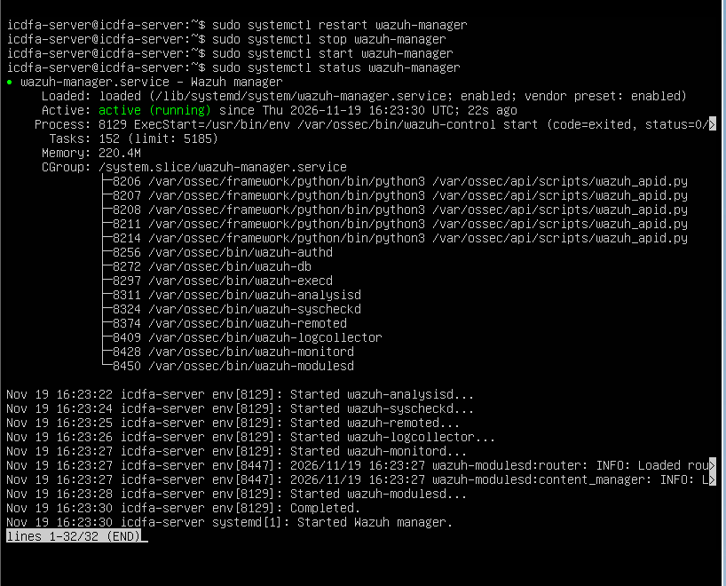
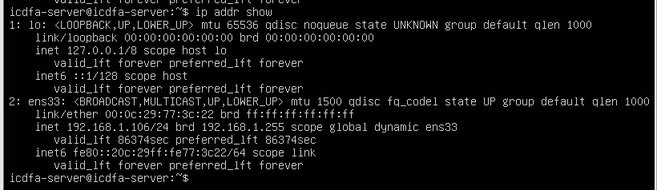
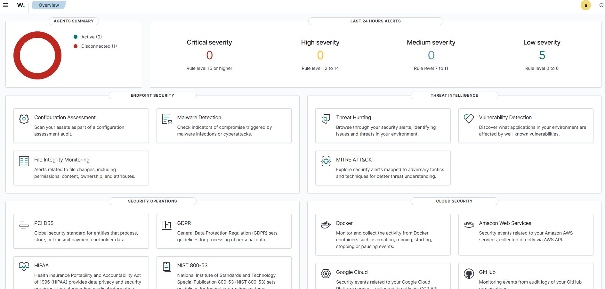
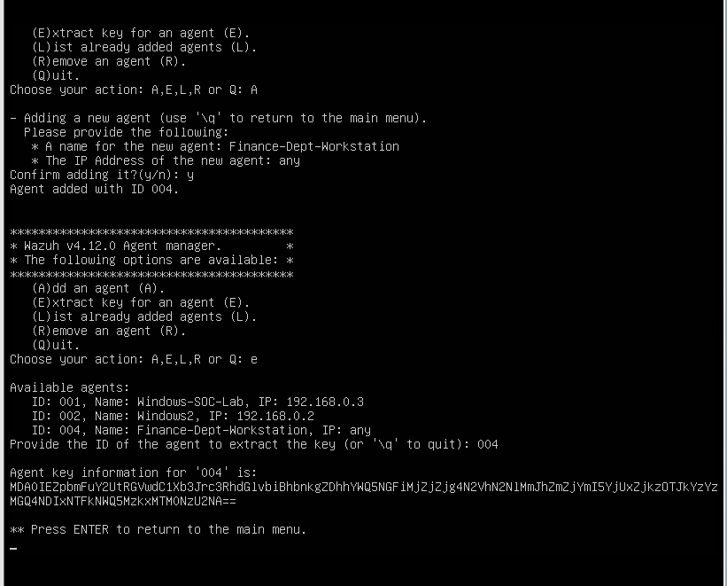
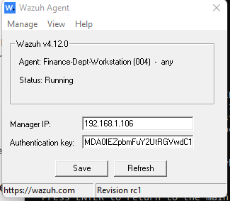
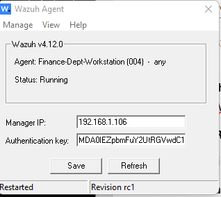
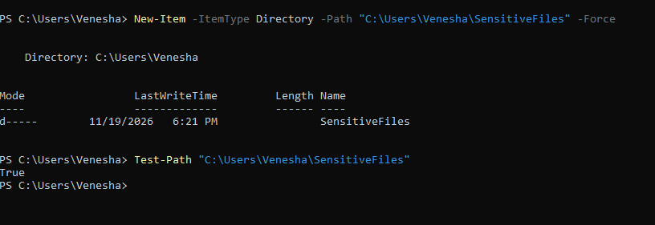
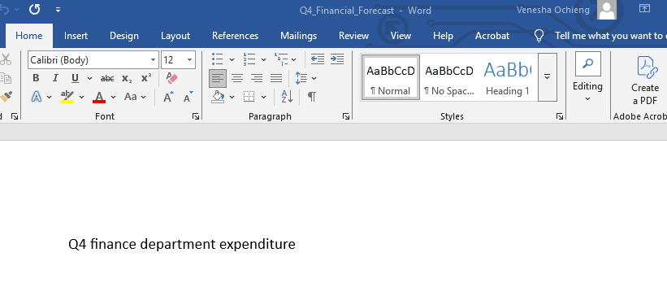
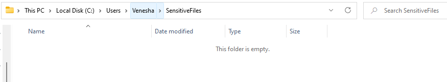

# INTERNATIONAL CYBERSECURITY AND DIGITAL FORENSICS ACADEMY

## GRC103 | Risk Monitoring with Wazuh - File Integrity Monitoring

**Full Name:** Venesha Adhiambo Ochieng  
**Registration Number:** C11/26/CGRCE/17566  
**Email Address:** c11.cgrce2617566@icdfa.edu.ng  
**Cohort / Batch:** Cohort11  
**Date Submitted:** 20th November 2026

## Scenario: A Governance and Risk Mandate

You are a GRC analyst. A recent risk assessment identified the **unauthorized modification or deletion of sensitive financial forecast documents** as a medium-to-high risk to the organization. The Risk Treatment Plan approved the implementation of a **detective control** to monitor for this activity.

Your task is to implement a solution that can:

1. Continuously monitor a designated folder (`C:\Users\<YourName>\SensitiveFiles`) on a key user's workstation.
2. Detect and log any creation, modification, or deletion of files within that folder.
3. Provide a centralized audit trail and real-time alerting to demonstrate the control's operation for compliance and monitoring purposes.

You have selected the open-source **Wazuh** platform to fulfill this requirement.

## Lab Architecture

| Component | Host | GRC Role |
|-----------|------|----------|
| Wazuh Manager | Ubuntu (VirtualBox) | The **Risk Monitoring Platform**. Aggregates and analyzes data for reporting. |
| Wazuh Agent | Windows (Host Machine) | The **Control Agent**. Installed on the asset (endpoint) being monitored. |

# Part 1: Deploying the Wazuh Manager (Ubuntu)

*Run the following steps on your Ubuntu VirtualBox server via a terminal window.*

## 1.1 Add Wazuh GPG Key

```bash
curl -s https://packages.wazuh.com/key/GPG-KEY-WAZUH | sudo gpg --dearmor -o /usr/share/keyrings/wazuh-archive-keyring.gpg
```


### 1.2 Download and Execute Installation Script

```bash
curl -sO https://packages.wazuh.com/4.12/wazuh-install.sh && sudo bash ./wazuh-install.sh -a -i
```


- `-a`: Installs **all** components.
- `-i`: Runs in **interactive** mode (follow any on-screen prompts).

**GRC Note:** In a production environment, the separation of these components would be a key **compensating control** to mitigate the risk of a single point of failure.

### 1.3 Wazuh Management Commands

```bash
sudo systemctl restart wazuh-manager
sudo systemctl stop wazuh-manager
sudo systemctl start wazuh-manager
sudo systemctl status wazuh-manager
```


# Part 2: Accessing the Wazuh Dashboard

### 2.1 Find your Ubuntu VM's IP address

```bash
ip addr show
```


### 2.2 Open a web browser and navigate to:

```text
https://<UBUNTU_VM_IP_ADDRESS>
```


### 2.3 Accept the browser security warning
(This is expected in a lab environment).

Log in using the credentials provided at the end of the installation script (default username is `admin`).



**GRC Note:** This dashboard serves as your **Risk & Control Monitoring Console**. It provides the evidence needed for compliance audits and ongoing risk assessments.

# Part 3: Installing the Wazuh Agent (Windows)

1. On your **Windows host**, download the Wazuh Agent MSI installer:

   ```text
   https://packages.wazuh.com/4.x/windows/wazuh-agent-4.12.0-1.msi
   ```

2. Run the MSI file and install it with the default settings.


# Part 4: Agent-Manager Registration
## 4.1 Generate Agent Key on Manager
On your **Ubuntu VM terminal**, run:

```bash
sudo /var/ossec/bin/manage_agents
```
- Press **A** to **Add an agent**.
- Enter a name (e.g., **Finance-Dept-Workstation**).
- For the IP address, you can leave it as **any**.
- Confirm and then press **E** to **Extract the key**.
- **Copy the generated key.**


## 4.2 Apply Key in the Windows Agent

1. On your **Windows host**, open the **Wazuh Agent Manager**.
2. Go to the **Management** tab.
3. Paste the key into the **Agent key** field.
4. In the **Manager address** field, enter the IP address of your **Ubuntu VM**.
5. Click **Apply** and then **Restart**.


### Verification

Go to the **Wazuh Dashboard** → **Agents**.

You should soon see your agent with a green **Active** status.


# Part 5: Implementing a Detective Control (File Integrity Monitoring)

We will now configure the **detective control** to monitor for the identified risk.

## 5.1 Edit Agent Configuration

1. On your **Windows host**, navigate to:

   ```text
   C:\Program Files (x86)\ossec-agent\
   ```

2. Open the **ossec.conf** file as Administrator.

3. Find the `<syscheck>` section.

4. Add the following line (replace `abc` with your Windows username):

```xml
<directories realtime="yes">C:\Users\AMINU IDRIS\SensitiveFiles</directories>
```


## 5.2 Restart the Agent

Restart the Wazuh agent from the **Wazuh Agent Manager** GUI or via **services.msc**.


# Part 6: Risk Monitoring & Control Verification

Now, you will verify that your control is operating effectively and generate risk-related events.

## 6.1 Create the Monitored Folder

Create the following folder on your Windows machine:

```text
C:\Users\abc\SensitiveFiles
```


## 6.2 Simulate a Risk Event

Perform these actions in the **SensitiveFiles** folder to simulate unauthorized activity:

- Create a new file (**Q4_Financial_Forecast.docx**).


- Modify the file by adding text.


- Delete the file.


## 6.3 Monitor Control Effectiveness in the Dashboard

- Go to the **Wazuh Dashboard**.
- Navigate to **Security Events**.
- Filter for:

```text
rule.groups: "syscheck"
```

to see only **File Integrity Monitoring** alerts.

- Click on alerts to view:
  - File path
  - Action (added/modified/deleted)
  - Timestamp
  - File checksums

These events provide evidence that the detective control is operating effectively and generating an auditable trail of file activity within the monitored **SensitiveFiles** directory.


# GRC Workshop & Analysis Questions

## 1. Risk Identification & Analysis

### 1.1 What is the potential business impact (e.g., financial, reputational, operational) if this risk were realized?

Unauthorized modification or deletion of sensitive financial documents presents significant financial, operational, reputational and compliance risks to an organization.

#### Financial Impact

Unauthorized changes to financial forecasts may result in inaccurate budgets, misleading financial projections and poor investment decisions. Management could allocate resources based on manipulated figures, potentially resulting in financial losses, fraud or misappropriation of organizational funds.

#### Operational Impact

Modification or deletion of critical financial records can disrupt budgeting, financial reporting and decision-making processes. Employees may spend considerable time investigating discrepancies, restoring documents and verifying the accuracy of financial information, leading to reduced productivity and operational delays.

#### Reputational Impact

If stakeholders discover that financial information has been compromised, they may lose confidence in the organization's ability to safeguard sensitive information. This can damage relationships with investors, customers, business partners and regulators.

#### Regulatory and Compliance Impact

Unauthorized alteration of financial records may compromise the integrity of financial reporting and lead to non-compliance with applicable regulatory requirements, including internal control obligations under the Sarbanes-Oxley Act (SOX), where applicable.

#### Risk Assessment

Given the sensitivity of financial documents, the risk can be classified as Medium to High, consistent with the scenario, depending on the likelihood of unauthorized modification and the potential business impact.

---

### 1.2 Based on the alerts you generated, how does this control help in quantifying the risk (e.g., frequency of events)?

File Integrity Monitoring helps quantify risk by generating measurable security events whenever monitored files are created, modified or deleted.

During the practical lab, the Wazuh Threat Hunting dashboard displayed the following file integrity alerts:

| Rule ID | Alert Description | Severity Level |
|----------|------------------|----------------|
| 554 | File added to the system | 5 |
| 550 | Integrity checksum changed | 7 |
| 553 | File deleted | 7 |

These alerts demonstrate Wazuh's ability to detect different categories of file changes. The exact monitored financial document associated with each alert must be confirmed from its event details.

The control supports risk quantification through:

- **Event frequency:** Counting file creation, modification and deletion events over a defined period.
- **Event severity:** Categorizing detected changes according to their assigned Wazuh alert levels.
- **Trend analysis:** Comparing the number of unexpected changes across days, weeks or months.
- **Response performance:** Measuring how quickly suspicious file changes are investigated and resolved.

**GRC Significance:** Wazuh provides measurable indicators that support ongoing risk assessment, risk prioritization and management reporting. These indicators can inform likelihood estimates but do not independently establish financial loss exposure.

---

## 2. Control Evaluation & Treatment

The implemented FIM is a **detective control**.

### 2.1 What would be a complementary preventive control for this same risk?

A suitable preventive control would be **Role-Based Access Control (RBAC), supported by the principle of least privilege**.

RBAC restricts access to sensitive financial documents according to employees' assigned responsibilities.

For example, finance managers may be authorized to modify financial forecasts, while other employees receive read-only access.

The organization should implement the following measures:

- Restrict modification and deletion permissions to authorized finance personnel.
- Apply least-privilege access through Windows NTFS file permissions.
- Require multifactor authentication where supported for access to relevant systems.
- Conduct periodic access reviews to remove unnecessary privileges.
- Require approval for changes to critical financial documents.

#### Relationship Between Controls

| Control Type | Example | Purpose |
|-------------|---------|---------|
| Preventive | RBAC and NTFS permissions | Restricts unauthorized changes |
| Detective | Wazuh File Integrity Monitoring | Identifies and records file changes |
| Corrective | Restore an approved document version | Recovers file integrity following an incident |

Combining these controls establishes a layered security approach that reduces the likelihood of unauthorized modifications while ensuring suspicious activity can be detected and addressed.

---

### 2.2 Explain a situation where the alert from this detective control would trigger a corrective control (a response action).

Consider a scenario where an unauthorized employee modifies **Q4_Financial_Forecast.docx** to manipulate projected revenue figures.

The Wazuh Agent detects the change and generates an integrity alert under **Rule ID 550**.

The security or GRC team investigates the alert by examining the affected file path, timestamp, checksum information and available user activity records.

If the modification is confirmed to be unauthorized, the organization initiates corrective actions:

- **Incident investigation:** Determine who modified the file, when the change occurred and whether it was authorized.
- **Containment:** Temporarily restrict the affected account's modification permissions if misuse is suspected.
- **File restoration:** Restore the financial document from a verified backup or approved version.
- **Access review:** Assess and correct excessive permissions that enabled the modification.
- **Control improvement:** Review the incident's root cause and strengthen preventive controls.
- **Verification:** Confirm that the restored document matches the approved version and that monitoring remains operational.

**GRC Significance:** File Integrity Monitoring provides the detection mechanism, while incident response and restoration procedures provide corrective action. Together, these controls support effective risk treatment and continuous improvement.

---

## 3. Risk Monitoring & Reporting

### 3.1 If you had to report on the operational effectiveness of this File Integrity Monitoring control to a manager, what three key metrics would you pull from the Wazuh dashboard?

The following three metrics would provide management with meaningful information about the operational effectiveness of the File Integrity Monitoring control.

| KPI / KRI | Description | Management Significance |
|------------|------------|------------------------|
| File Integrity Event Frequency | Number of file additions, modifications and deletions detected during a defined period | Measures change activity and identifies unusual trends |
| Unauthorized Change Detection Rate | Percentage of confirmed unauthorized file changes that generated File Integrity Monitoring alerts | Evaluates whether the detective control is identifying relevant security events |
| Mean Time to Respond (MTTR) | Average time between detection of an unauthorized modification and completion of the response | Evaluates the efficiency of investigation and corrective action |

#### Metric 1 - File Integrity Event Frequency

Wazuh records file changes through alerts such as Rule 554 (file added), Rule 550 (integrity checksum changed) and Rule 553 (file deleted).

Monitoring these alerts enables management to identify unusual increases in file modification activity.

#### Metric 2 - Unauthorized Change Detection Rate

This measures the proportion of independently verified unauthorized file changes that were detected by the File Integrity Monitoring control.

\[
\text{Detection Rate} =
\frac{\text{Detected Unauthorized Changes}}
{\text{Total Verified Unauthorized Changes}}
\times 100
\]

The denominator requires an independent source of verified changes, such as controlled tests or incident investigations. Wazuh alerts alone cannot establish this metric.

#### Metric 3 - Mean Time to Respond

This measures how quickly the organization responds to confirmed unauthorized file modifications.

\[
\text{MTTR} =
\frac{\text{Total Response Time}}
{\text{Number of Resolved Incidents}}
\]

Wazuh provides alert timestamps, while incident management records supply response and resolution times.

**Practical Observation:** During the lab, the dashboard displayed file creation, checksum modification and deletion alerts. This demonstrates File Integrity Monitoring event generation, but an effectiveness percentage and MTTR cannot be calculated without additional test coverage and response records.

---

### 3.2 How does centralizing this monitoring data, as opposed to checking logs on each individual computer, improve the governance and auditability of the risk management program?

Centralized monitoring improves governance, accountability, operational efficiency and auditability by consolidating security events from multiple endpoints into a single monitoring platform.

- **Improved Security Visibility:** Wazuh enables security teams to monitor multiple workstations through one dashboard rather than manually reviewing individual device logs.
- **Consistent Control Monitoring:** Centralized collection supports consistent alert classification, event analysis and security reporting across monitored endpoints.
- **Enhanced Accountability:** Events are associated with monitored agents, timestamps, affected file paths and detection rules. These details support investigations and the identification of responsible systems.
- **Improved Auditability:** Centralized records provide evidence that security monitoring controls are operating. Auditors can review historical alerts, monitoring coverage and relevant investigations without accessing every endpoint individually.
- **Faster Incident Identification:** Security analysts can identify suspicious file changes and prioritize investigations using severity levels and event patterns.
- **Governance Reporting:** Aggregated security metrics allow management and the risk committee to evaluate trends, identify control weaknesses and make informed risk treatment decisions.

**GRC Significance:** Centralized monitoring strengthens oversight and supports evidence-based governance. Its effectiveness still depends on appropriate access restrictions, log retention, time synchronization and protection of monitoring records from unauthorized alteration.

---

## 4. Compliance Mapping

Many regulations (like SOX, PCI DSS, HIPAA) require monitoring critical files for changes.

### 4.1 How does a tool like Wazuh provide evidence for compliance audits?

Wazuh provides technical evidence that can help organizations demonstrate the implementation and operation of security monitoring controls.

Through File Integrity Monitoring, Wazuh records changes to monitored files and generates alerts containing information such as:

- Monitored agent name and identification number.
- Affected file name and path.
- File change type: added, modified or deleted.
- Event timestamp.
- Detection rule ID and severity level.
- File checksums before and after modifications, when available.

This information helps auditors evaluate whether file integrity controls are implemented and whether suspicious changes are detected.

#### Relevant Compliance Frameworks

| Framework | Relevant Requirement or Principle | How Wazuh Supports It |
|-----------|----------------------------------|----------------------|
| SOX | Internal controls supporting reliable financial reporting | Provides change-monitoring evidence for systems containing financially significant information |
| PCI DSS 4.0 | Requirement 11.5.2 - Change-detection mechanisms for critical files | Helps identify unauthorized changes to monitored critical files |
| HIPAA Security Rule | Audit controls and integrity safeguards, where applicable | Supports monitoring and investigation of changes to electronic protected health information |
| ISO/IEC 27001:2022 | Annex A 8.15 - Logging and 8.16 - Monitoring activities | Supports collection, review and analysis of security events |
| NIST CSF 2.0 | DE.CM - Continuous Monitoring | Supports detection and monitoring of relevant endpoint events |

Wazuh evidence contributes to compliance assessments but does not independently establish full compliance with any regulation or framework.

---

### 4.2 Briefly describe how you would use the Wazuh dashboard to demonstrate to an auditor that a specific sensitive file has not been altered during a defined period (e.g., last quarter).

#### Step 1 - Identify the Sensitive File

Select the monitored financial document:

```text
C:\Users\Venesha\SensitiveFiles\Q4_Financial_Forecast.docx
```

Confirm that the Windows workstation was monitored by the Wazuh Agent throughout the period under review.

#### Step 2 - Establish the Audit Period

Set the Wazuh Dashboard time range to the relevant quarter, for example **1 July to 30 September 2026**.

#### Step 3 - Filter File Integrity Events

Navigate to **Threat Hunting** or **File Integrity Monitoring** and apply a filter for File Integrity Monitoring events, such as:

```text
rule.groups: "syscheck"
```

Then narrow the results to the specified agent and financial document path.

#### Step 4 - Review the Monitoring History

Review any alerts indicating file creation, modification, checksum changes or deletion.

If there are no relevant alerts, investigate whether monitoring was continuously enabled and whether event collection and retention covered the entire quarter.

#### Step 5 - Verify File Integrity

Compare the file's current cryptographic checksum with its approved baseline checksum, if available.

Matching checksums provide evidence that the contents have not changed relative to the baseline, subject to the integrity of the hashing process and records.

#### Step 6 - Export Audit Evidence

Prepare an audit evidence package containing:

- File Integrity Monitoring configuration and monitored directory.
- Agent status and monitoring coverage for the audit period.
- Baseline and current checksum comparison.
- Relevant Wazuh event records or search results.
- Evidence of log retention and investigation of any monitoring gaps.

#### Step 7 - Document the Conclusion

If the baseline and current hashes match, no unauthorized changes are identified, and monitoring coverage is demonstrated throughout the quarter, the evidence supports a conclusion that the file's integrity was maintained during the period under review.

However, the absence of Wazuh alerts alone does not prove that a file was never altered. Monitoring gaps, missing records or temporary changes subsequently reversed must be considered.

---

# Conclusion

The GRC103 Wazuh practical exercise demonstrated how technical security monitoring can support organizational risk management.

The Wazuh Manager was deployed on an Ubuntu virtual machine, and the Windows workstation was registered as Agent 004. File Integrity Monitoring was configured to detect changes within the **SensitiveFiles** directory.

The Threat Hunting dashboard displayed file creation, integrity checksum modification and deletion alerts, corresponding to Wazuh Rules **554**, **550** and **553**.

These observations demonstrate that Wazuh is generating file-integrity events. Confirmation that all three alerts correspond specifically to **Q4_Financial_Forecast.docx** requires inspection of the individual event file paths.

From a GRC perspective, the exercise demonstrates the importance of combining preventive access controls, detective monitoring and corrective incident response procedures.

Wazuh provides a practical mechanism for monitoring sensitive files, supporting audit evidence collection and improving visibility into information integrity risks.
