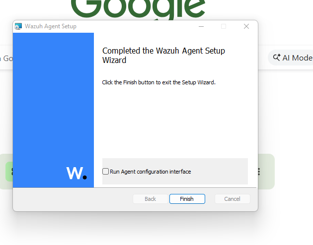

# INTERNATIONAL CYBERSECURITY AND DIGITAL FORENSICS ACADEMY

## GRC103 | Risk Monitoring with Wazuh - File Integrity Monitoring

**Full Name:** Venesha Adhiambo Ochieng  
**Registration Number:** C11/26/CGRCE/17566  
**Email Address:** c11.cgrce2617566@icdfa.edu.ng  
**Cohort / Batch:** Cohort11  
**Date Submitted:** 20th November 2026

## Scenario: A Governance and Risk Mandate

You are a GRC analyst. A recent risk assessment identified the **unauthorized modification or deletion of sensitive financial forecast documents** as a medium-to-high risk to the organization. The Risk Treatment Plan approved the implementation of a **detective control** to monitor for this activity.

Your task is to implement a solution that can:

1. Continuously monitor a designated folder (`C:\Users\<YourName>\SensitiveFiles`) on a key user's workstation.
2. Detect and log any creation, modification, or deletion of files within that folder.
3. Provide a centralized audit trail and real-time alerting to demonstrate the control's operation for compliance and monitoring purposes.

You have selected the open-source **Wazuh** platform to fulfill this requirement.

## Lab Architecture

| Component | Host | GRC Role |
|-----------|------|----------|
| Wazuh Manager | Ubuntu (VirtualBox) | The **Risk Monitoring Platform**. Aggregates and analyzes data for reporting. |
| Wazuh Agent | Windows (Host Machine) | The **Control Agent**. Installed on the asset (endpoint) being monitored. |

# Part 1: Deploying the Wazuh Manager (Ubuntu)

*Run the following steps on your Ubuntu VirtualBox server via a terminal window.*

## 1.1 Add Wazuh GPG Key

```bash
curl -s https://packages.wazuh.com/key/GPG-KEY-WAZUH | sudo gpg --dearmor -o /usr/share/keyrings/wazuh-archive-keyring.gpg
```


### 1.2 Download and Execute Installation Script

```bash
curl -sO https://packages.wazuh.com/4.12/wazuh-install.sh && sudo bash ./wazuh-install.sh -a -i
```


- `-a`: Installs **all** components.
- `-i`: Runs in **interactive** mode (follow any on-screen prompts).

**GRC Note:** In a production environment, the separation of these components would be a key **compensating control** to mitigate the risk of a single point of failure.

### 1.3 Wazuh Management Commands

```bash
sudo systemctl restart wazuh-manager
sudo systemctl stop wazuh-manager
sudo systemctl start wazuh-manager
sudo systemctl status wazuh-manager
```


# Part 2: Accessing the Wazuh Dashboard

### 2.1 Find your Ubuntu VM's IP address

```bash
ip addr show
```


### 2.2 Open a web browser and navigate to:

```text
https://<UBUNTU_VM_IP_ADDRESS>
```


### 2.3 Accept the browser security warning
(This is expected in a lab environment).

Log in using the credentials provided at the end of the installation script (default username is `admin`).


**GRC Note:** This dashboard serves as your **Risk & Control Monitoring Console**. It provides the evidence needed for compliance audits and ongoing risk assessments.

# Part 3: Installing the Wazuh Agent (Windows)

1. On your **Windows host**, download the Wazuh Agent MSI installer:

   ```text
   https://packages.wazuh.com/4.x/windows/wazuh-agent-4.12.0-1.msi
   ```

2. Run the MSI file and install it with the default settings.


# Part 4: Agent-Manager Registration
## 4.1 Generate Agent Key on Manager
On your **Ubuntu VM terminal**, run:

```bash
sudo /var/ossec/bin/manage_agents
```
- Press **A** to **Add an agent**.
- Enter a name (e.g., **Finance-Dept-Workstation**).
- For the IP address, you can leave it as **any**.
- Confirm and then press **E** to **Extract the key**.
- **Copy the generated key.**


## 4.2 Apply Key in the Windows Agent

1. On your **Windows host**, open the **Wazuh Agent Manager**.
2. Go to the **Management** tab.
3. Paste the key into the **Agent key** field.
4. In the **Manager address** field, enter the IP address of your **Ubuntu VM**.
5. Click **Apply** and then **Restart**.


### Verification

Go to the **Wazuh Dashboard** → **Agents**.

You should soon see your agent with a green **Active** status.


# Part 5: Implementing a Detective Control (File Integrity Monitoring)

We will now configure the **detective control** to monitor for the identified risk.

## 5.1 Edit Agent Configuration

1. On your **Windows host**, navigate to:

   ```text
   C:\Program Files (x86)\ossec-agent\
   ```

2. Open the **ossec.conf** file as Administrator.

3. Find the `<syscheck>` section.

4. Add the following line (replace `abc` with your Windows username):

```xml
<directories realtime="yes">C:\Users\AMINU IDRIS\SensitiveFiles</directories>
```

## 5.2 Restart the Agent

Restart the Wazuh agent from the **Wazuh Agent Manager** GUI or via **services.msc**.

# Part 6: Risk Monitoring & Control Verification

Now, you will verify that your control is operating effectively and generate risk-related events.

## 6.1 Create the Monitored Folder

Create the following folder on your Windows machine:

```text
C:\Users\abc\SensitiveFiles
```

## 6.2 Simulate a Risk Event

Perform these actions in the **SensitiveFiles** folder to simulate unauthorized activity:

- Create a new file (**Q4_Financial_Forecast.docx**).
- Modify the file by adding text.
- Delete the file.

## 6.3 Monitor Control Effectiveness in the Dashboard

- Go to the **Wazuh Dashboard**.
- Navigate to **Security Events**.
- Filter for:

```text
rule.groups: "syscheck"
```

to see only **File Integrity Monitoring** alerts.

- Click on alerts to view:
  - File path
  - Action (added/modified/deleted)
  - Timestamp
  - File checksums

These events provide evidence that the detective control is operating effectively and generating an auditable trail of file activity within the monitored **SensitiveFiles** directory.
