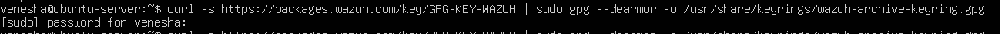
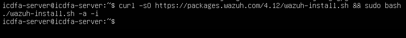
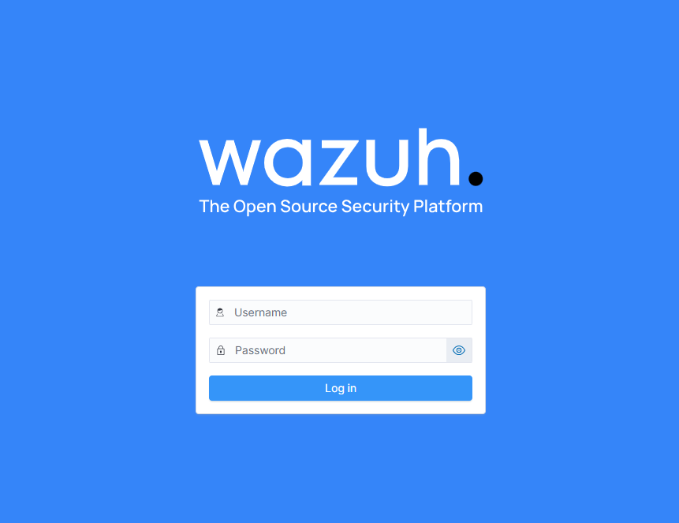
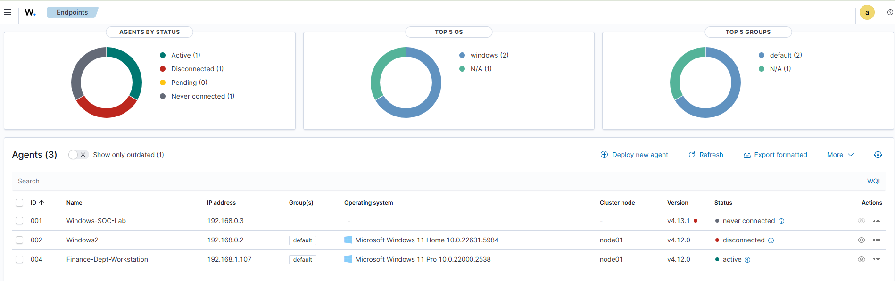
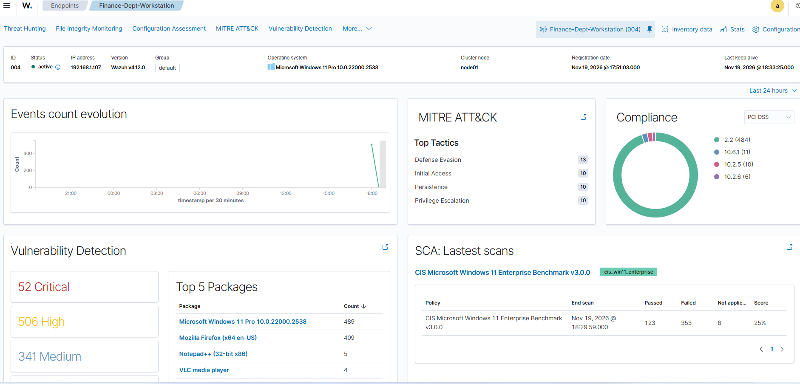
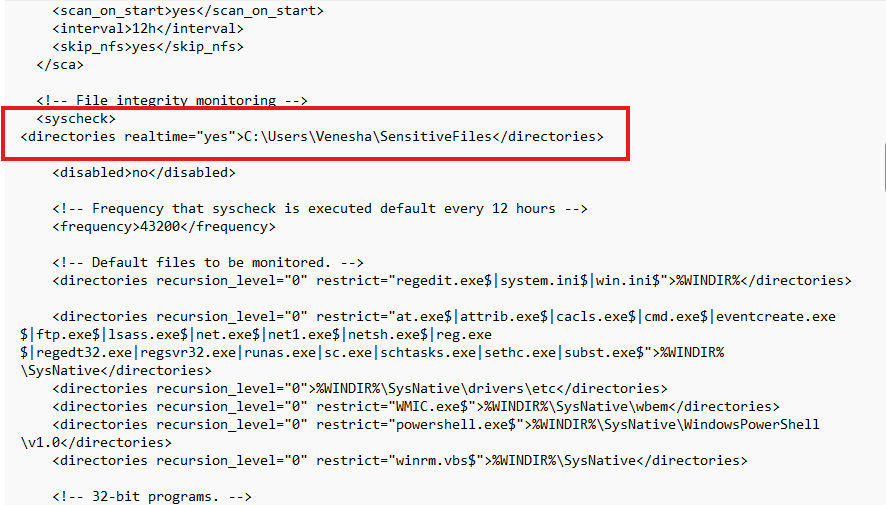
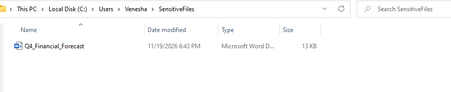
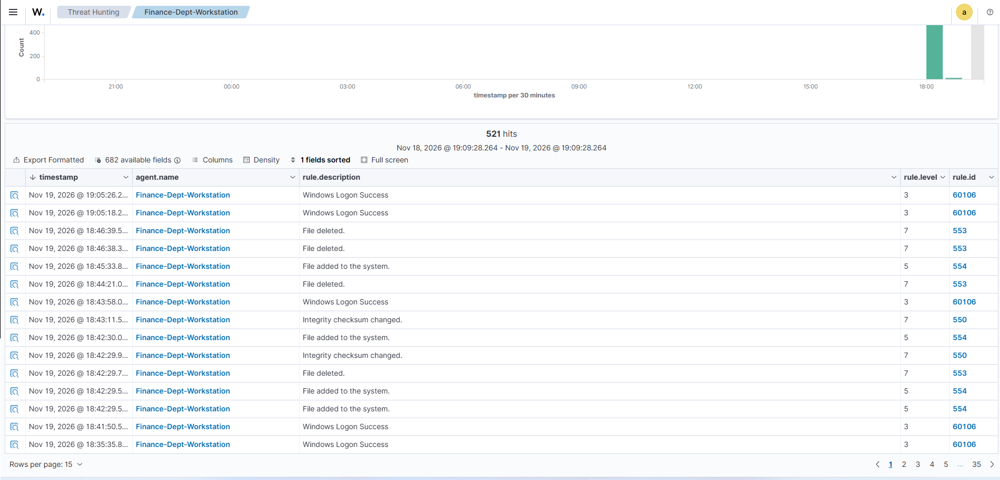

# INTERNATIONAL CYBERSECURITY AND DIGITAL FORENSICS ACADEMY

## GRC103 | Risk Monitoring with Wazuh - File Integrity Monitoring

**Full Name:** Venesha Adhiambo Ochieng  
**Registration Number:** C11/26/CGRCE/17566  
**Email Address:** c11.cgrce2617566@icdfa.edu.ng  
**Cohort / Batch:** Cohort11  
**Date Submitted:** 20th November 2026

## Scenario: A Governance and Risk Mandate

You are a GRC analyst. A recent risk assessment identified the **unauthorized modification or deletion of sensitive financial forecast documents** as a medium-to-high risk to the organization. The Risk Treatment Plan approved the implementation of a **detective control** to monitor for this activity.

Your task is to implement a solution that can:

1. Continuously monitor a designated folder (`C:\Users\<YourName>\SensitiveFiles`) on a key user's workstation.
2. Detect and log any creation, modification, or deletion of files within that folder.
3. Provide a centralized audit trail and real-time alerting to demonstrate the control's operation for compliance and monitoring purposes.

You have selected the open-source **Wazuh** platform to fulfill this requirement.

## Lab Architecture

| Component | Host | GRC Role |
|-----------|------|----------|
| Wazuh Manager | Ubuntu (VirtualBox) | The **Risk Monitoring Platform**. Aggregates and analyzes data for reporting. |
| Wazuh Agent | Windows (Host Machine) | The **Control Agent**. Installed on the asset (endpoint) being monitored. |

# Part 1: Deploying the Wazuh Manager (Ubuntu)

*Run the following steps on your Ubuntu VirtualBox server via a terminal window.*

## 1.1 Add Wazuh GPG Key

```bash
curl -s https://packages.wazuh.com/key/GPG-KEY-WAZUH | sudo gpg --dearmor -o /usr/share/keyrings/wazuh-archive-keyring.gpg
```


### 1.2 Download and Execute Installation Script

```bash
curl -sO https://packages.wazuh.com/4.12/wazuh-install.sh && sudo bash ./wazuh-install.sh -a -i
```


- `-a`: Installs **all** components.
- `-i`: Runs in **interactive** mode (follow any on-screen prompts).

**GRC Note:** In a production environment, the separation of these components would be a key **compensating control** to mitigate the risk of a single point of failure.

### 1.3 Wazuh Management Commands

```bash
sudo systemctl restart wazuh-manager
sudo systemctl stop wazuh-manager
sudo systemctl start wazuh-manager
sudo systemctl status wazuh-manager
```


# Part 2: Accessing the Wazuh Dashboard

### 2.1 Find your Ubuntu VM's IP address

```bash
ip addr show
```


### 2.2 Open a web browser and navigate to:

```text
https://<UBUNTU_VM_IP_ADDRESS>
```


### 2.3 Accept the browser security warning
(This is expected in a lab environment).

Log in using the credentials provided at the end of the installation script (default username is `admin`).


**GRC Note:** This dashboard serves as your **Risk & Control Monitoring Console**. It provides the evidence needed for compliance audits and ongoing risk assessments.

# Part 3: Installing the Wazuh Agent (Windows)

1. On your **Windows host**, download the Wazuh Agent MSI installer:

   ```text
   https://packages.wazuh.com/4.x/windows/wazuh-agent-4.12.0-1.msi
   ```

2. Run the MSI file and install it with the default settings.


# Part 4: Agent-Manager Registration
## 4.1 Generate Agent Key on Manager
On your **Ubuntu VM terminal**, run:

```bash
sudo /var/ossec/bin/manage_agents
```
- Press **A** to **Add an agent**.
- Enter a name (e.g., **Finance-Dept-Workstation**).
- For the IP address, you can leave it as **any**.
- Confirm and then press **E** to **Extract the key**.
- **Copy the generated key.**


## 4.2 Apply Key in the Windows Agent

1. On your **Windows host**, open the **Wazuh Agent Manager**.
2. Go to the **Management** tab.
3. Paste the key into the **Agent key** field.
4. In the **Manager address** field, enter the IP address of your **Ubuntu VM**.
5. Click **Apply** and then **Restart**.


### Verification

Go to the **Wazuh Dashboard** → **Agents**.

You should soon see your agent with a green **Active** status.




# Part 5: Implementing a Detective Control (File Integrity Monitoring)

We will now configure the **detective control** to monitor for the identified risk.

## 5.1 Edit Agent Configuration

1. On your **Windows host**, navigate to:

   ```text
   C:\Program Files (x86)\ossec-agent\
   ```

2. Open the **ossec.conf** file as Administrator.

3. Find the `<syscheck>` section.

4. Add the following line (replace `abc` with your Windows username):

```xml
<directories realtime="yes">C:\Users\AMINU IDRIS\SensitiveFiles</directories>
```


## 5.2 Restart the Agent

Restart the Wazuh agent from the **Wazuh Agent Manager** GUI or via **services.msc**.


# Part 6: Risk Monitoring & Control Verification

Now, you will verify that your control is operating effectively and generate risk-related events.

## 6.1 Create the Monitored Folder

Create the following folder on your Windows machine:

```text
C:\Users\abc\SensitiveFiles
```


## 6.2 Simulate a Risk Event

Perform these actions in the **SensitiveFiles** folder to simulate unauthorized activity:

- Create a new file (**Q4_Financial_Forecast.docx**).


- Modify the file by adding text.


- Delete the file.


## 6.3 Monitor Control Effectiveness in the Dashboard

- Go to the **Wazuh Dashboard**.
- Navigate to **Security Events**.
- Filter for:

```text
rule.groups: "syscheck"
```

to see only **File Integrity Monitoring** alerts.

- Click on alerts to view:
  - File path
  - Action (added/modified/deleted)
  - Timestamp
  - File checksums

These events provide evidence that the detective control is operating effectively and generating an auditable trail of file activity within the monitored **SensitiveFiles** directory.



## 12.1 First-Year Risk Treatment Cost Comparison

The first-year cost is calculated as:

**First-Year Cost = Setup Cost + Labour Cost + Annual Recurring Cost**

| Cost Component | Option A: Hardening | Option B: Managed Backup | Option C: TLS |
|----------------|--------------------|--------------------------|--------------|
| Setup cost | $0 | $120 | $0 |
| Labour hours | 4 | 0 (not specified) | 3 |
| Labour rate | $25/hr | Not specified | $25/hr |
| Labour cost | $100 | $0 assumed | $75 |
| Annual maintenance / recurring | $50 | $240 | $25 |
| Total first-year cost | $150 | $360 | $100 |

### Cost Calculations

**Option A – Hardening**

(4 × $25) + $50 = $150

**Option B – Managed Backup**

$120 + (12 × $20) = $360

**Option C – TLS Deployment**

(3 × $25) + $25 = $100

### First-Year Security Control Costs

#### Recommended Control Combination

Northbridge Services should adopt Options A + B + C as a proposed layered treatment strategy, subject to management approval.

| Option | First-Year Cost | Justification |
|----------|---------------|--------------|
| A – Hardening | $150 | Maintains reduced attack surface, archive restrictions and controlled network access. |
| B – Managed Backup | $360 | Addresses the limitations of same-host backups through separately protected recovery arrangements. |
| C – TLS Deployment | $100 | Reduces the remaining risk of HTTP traffic interception and modification. |
| Combined investment | $610 | Addresses preventive, corrective and communication-security weaknesses. |

Option A's technical controls have been tested in the laboratory. Option B remains a fictional service proposal, and Option C has not been implemented or validated. Therefore, the combined investment is a recommendation, not an expenditure already incurred. 【1-138756】

### Excluded Costs

The cost estimates exclude additional hardware, storage expansion, system downtime, staff training, monitoring software, vendor due diligence, contract management, incident response, backup-storage growth, certificate-related expenses and other operational costs not specified in the assignment.

Consequently, the $610 estimate represents only the fictional first-year costs of the three stated options. 【1-138756】

---

## 12.2 Illustrative Backup Cost-Benefit Analysis

This analysis applies only to the separate backup scenario prescribed in the assignment.

### Financial Assumptions

| Parameter | Assumed Value |
|------------|--------------|
| Annual Rate of Occurrence (ARO) | 0.2 events/year |
| Baseline loss per event (SLE) | $5,000 |
| Residual loss per event after tested recovery | $1,000 |
| Option B first-year cost | $360 |

These figures are hypothetical. The successful Step 10 recovery test does not independently establish the assumed incident frequency, financial losses or expected savings. 【1-138756】

### 12.2.1 Baseline Annualised Loss Expectancy

**Baseline ALE = ARO × Baseline SLE**

0.2 × $5,000 = **$1,000**

### 12.2.2 Residual Annualised Loss Expectancy

**Residual ALE = ARO × Residual SLE**

0.2 × $1,000 = **$200**

### 12.2.3 Annual Expected Benefit

**Annual Benefit = Baseline ALE − Residual ALE**

$1,000 − $200 = **$800**

### 12.2.4 First-Year Net Benefit

**Net Benefit = Annual Benefit − Option B Cost**

$800 − $360 = **$440**

The scenario indicates that the assumed annual benefit of $800 exceeds the $360 first-year cost of Option B, producing a positive illustrative net benefit of $440.

However, this result depends entirely on the prescribed assumptions. Managed backup implementation and its financial benefits have not been validated in the laboratory.

No financial benefit is assigned to Options A or C because the assignment does not provide separate loss-reduction estimates for those controls. Overlapping control benefits must not be added together. 【1-138756】

---

## 12.3 Residual Risk Reassessment (R1–R4)

Following the technical risk treatment activities completed in Steps 6–10, the four baseline risks were reassessed using the observed control effectiveness.

Residual risk represents the exposure remaining after implemented controls have been considered.

\[
\text{Residual Risk Score}=\text{Residual Likelihood}\times\text{Residual Impact}
\]

The residual scores below are proposed qualitative assessments based on the available evidence. They are not automatically reduced simply because a control was configured.

### 12.3.1 Residual Risk Register

| Risk | Baseline Risk | Residual Likelihood | Residual Impact | Residual Score | Rating |
|--------|--------------|--------------------|----------------|---------------|---------|
| R1 - Unnecessary Legacy Service | 16 - High | 1 | 4 | 4 | Low |
| R2 - Exposed Archive | 16 - High | 2 | 4 | 8 | Medium |
| R3 - Unauthorised Network Access | 12 - High | 2 | 4 | 8 | Medium |
| R4 - Loss of Portal Content | 12 - High | 3 | 3 | 9 | Medium |

### 12.3.2 Residual Risk Evidence, Ownership and Review Triggers

| Risk | Technical Evidence and Control Effectiveness | Treatment Owner | Review Trigger |
|--------|--------------------------------------------|----------------|---------------|
| R1 | grc-legacy.service confirmed inactive and disabled; Nmap confirmed TCP 8080 closed while TCP 80 remained open. **Verified at test time.** | IT Infrastructure / Server Administrator | Legacy service reactivation, unexpected reopening of TCP 8080 or unauthorised configuration changes. |
| R2 | Archive relocated; Nginx syntax passed; direct dummy-file request HTTP 403. Specific post-treatment /archive/ check not retained in reviewed evidence. **Partially verified.** | Web Administrator / Asset Owner | Archive becomes accessible, HTTP 200 appears for a protected path or permissions drift. |
| R3 | Approved HTTP 200; UFW BLOCK log SRC=192.168.224.131 DST=192.168.224.133 DPT=80. **Verified for tested source.** | Network Security Administrator | Unexpected open ports, firewall-rule changes or successful access from an unauthorised source. |
| R4 | Local restore command completed; SHA-256 OK; restored HTTP 200. Full recovery start time and failed-service response not retained in reviewed evidence. **Partially verified.** | Backup Administrator | Failed recovery test, integrity mismatch, host failure, backup loss or unacceptable recovery delay. |

### 12.3.3 Residual Risk Analysis

#### R1 - Unnecessary Legacy Service: Low (4)

The legacy endpoint was successfully disabled, and the post-treatment scan confirmed TCP port 8080 was closed. The likelihood is provisionally reduced from 4 to 1, while the potential impact remains 4 because the service could be reintroduced through configuration changes. Continued monitoring is necessary to detect reactivation.

#### R2 - Exposed Archive: Medium (8)

Moving archived files outside the Nginx web root, restricting permissions and denying access to the previous URL substantially reduces the likelihood of unauthorised disclosure. The residual likelihood is provisionally reduced to 2, while impact remains 4. Final validation should retain a direct `/archive/` HTTP 403 response.

#### R3 - Unauthorised Network Access: Medium (8)

UFW source-IP restrictions reduce exposure to unauthorised network clients. The successful approved request and corresponding firewall block logs support the likelihood reduction to 2. Impact remains 4 because successful exploitation through an authorised connection or misconfiguration could still affect the server.

#### R4 - Loss of Portal Content: Medium (9)

The successful SHA-256 check and restored HTTP 200 response demonstrate useful file-level recovery capability. Nevertheless, the backup is stored on the same host, and complete host-loss recovery has not been demonstrated. The residual risk remains Medium and requires continued treatment through backup enhancement and recovery validation. 【1-138756】

---

## 12.4 Control Effectiveness and Treatment Decision

The evidence demonstrates that several implemented controls achieved their immediate technical objectives. However, their longer-term effectiveness requires monitoring and periodic testing.

The following treatment decisions are recommended:

- **Risk avoidance:** Retain the disabled legacy endpoint and monitor for configuration drift.
- **Risk mitigation:** Maintain archive restrictions and UFW controls, with periodic testing.
- **Risk transfer:** Evaluate the proposed managed-backup service to address the limitations of same-host recovery.
- **Risk acceptance:** Temporarily accept plain HTTP only under the conditions documented in Step 11, pending TLS deployment or risk reassessment.

The $440 illustrative financial net benefit applies only to the separate Option B backup scenario. It must not be treated as verified savings or combined with unquantified benefits from other controls. 【1-138756】

## 12.5 Step 12 Conclusion

The cost-benefit and residual risk assessment demonstrates that Northbridge Services can adopt a combination of hardening, managed backup and TLS deployment at a fictional combined first-year cost of $610. 【1-138756】

The illustrative managed-backup scenario produces a baseline ALE of $1,000, residual ALE of $200, annual expected benefit of $800 and first-year net benefit of $440. These values depend on classroom assumptions and have not been established through observed financial outcomes. 【1-138756】

The residual risk reassessment indicates that the implemented controls have reduced exposure associated with the retired legacy service, archive disclosure and unauthorised network access. However, the loss-of-portal-content risk remains dependent on backup architecture limitations and recovery assurance evidence. 【1-138756】

Further treatment should prioritise separately protected recovery arrangements, completion of outstanding control-validation evidence, TLS implementation where required and continuous monitoring. 【1-138756】

**Calculation workbook:** GRC103_Week 3 Practical Lab Technical Risk Treatment - Implementing and Validating Security Controls_C11-26-CGRCE-17566_Venesha_Ochieng.xlsx 【1-138756】

### Technical References

- Ubuntu Server Firewall Documentation: https://ubuntu.com/server/docs/firewalls/
- NGINX Directory Listing: https://nginx.org/en/docs/http/ngx_http_autoindex_module.html
- NGINX Access Logging: https://nginx.org/en/docs/http/ngx_http_log_module.html
- Course Basis: ICDFA Risk Treatment Strategies slides, GRC103 Module 3.
